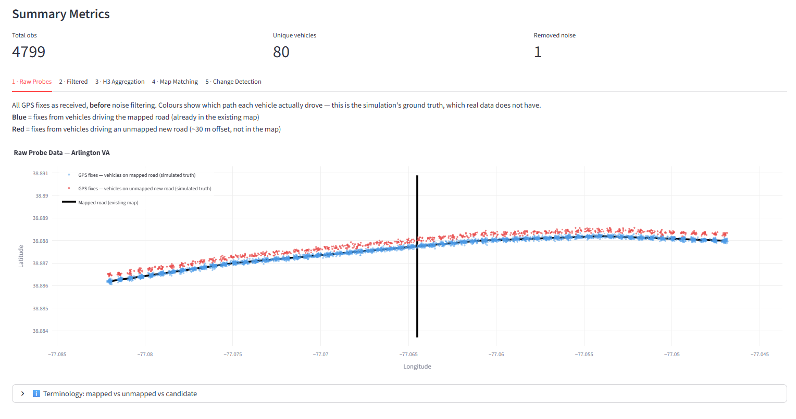
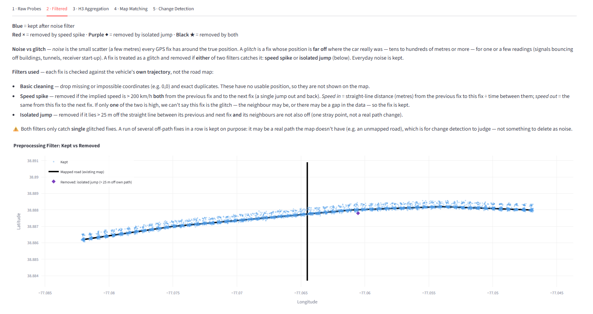
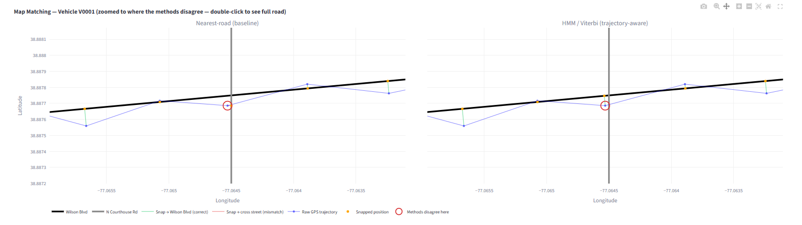
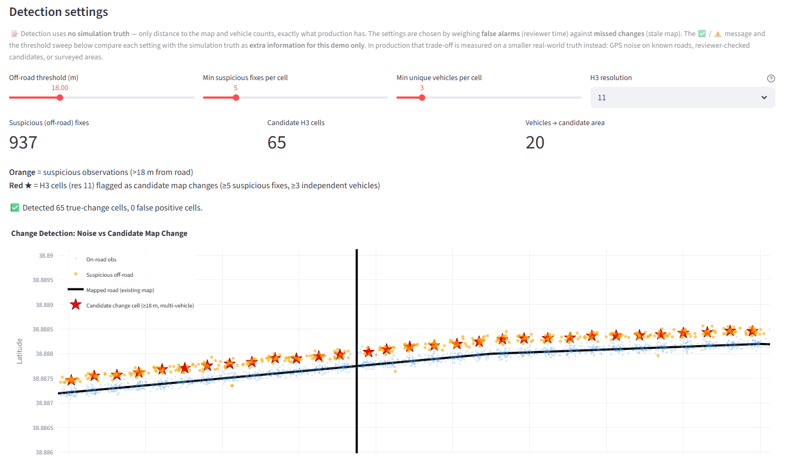
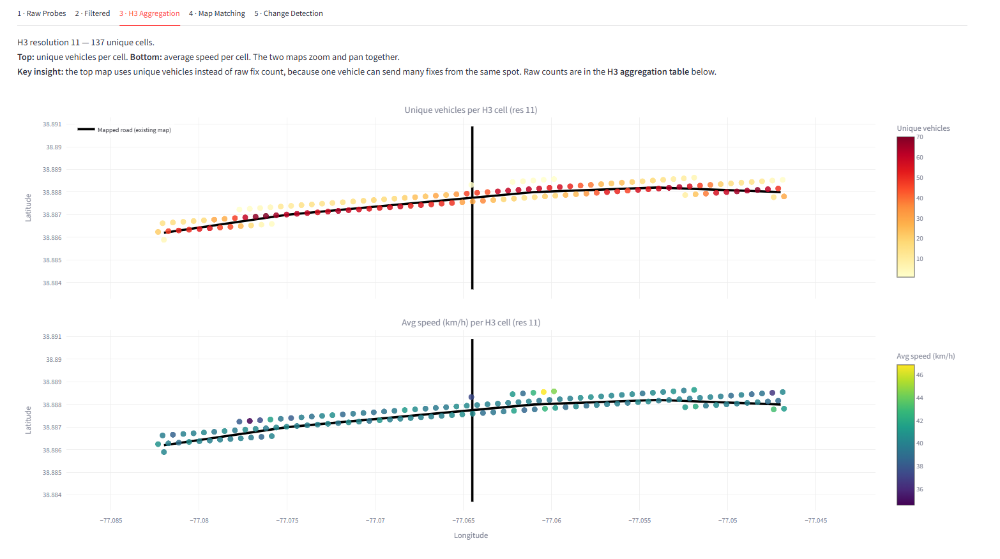

# vehicle-probe-spatial-indexing

A Python prototype showing how vehicle GPS/probe data is cleaned, spatially indexed,
map-matched, and analysed to detect candidate road-network changes — on a small,
synthetic, locally runnable dataset with an interactive Streamlit dashboard.

---

## The Problem

Automotive mapping companies continuously collect billions of GPS/probe observations
from vehicles. From this data they keep the road map up to date (new roads, geometry
changes, lane additions), detect speed and congestion patterns, and infer turn
restrictions and road classes.

**The core challenge:** a single GPS fix far from the mapped road could be noise, or
it could be a sign the map is wrong. Telling these apart requires cleaning, spatial
aggregation over many independent vehicles, and map matching.

---

## Pipeline

```
Raw GPS fixes
   → glitch filtering        remove single fixes inconsistent with the vehicle's own path
   → H3 indexing             assign each fix to hexagonal cells (res 9 / 10 / 11)
   → map matching            which existing road is each fix on? (nearest-road vs HMM)
   → change detection        is there a road here the map is missing?
```

Everything runs in Python: exact distances use the real road geometry (Shapely, in
metres via UTM); H3 is used only for grouping, never for distances.

---

## Dashboard Tour

| Tab | What it shows |
|---|---|
| **1 · Raw Probes** | All fixes before filtering, coloured by the simulation's truth (which real data does not have) |
| **2 · Filtered** | Fixes kept vs removed, with each removed fix marked by the filter that caught it |
| **3 · H3 Aggregation** | Unique vehicles and average speed per H3 cell (linked maps), plus the cell table |
| **4 · Map Matching** | Nearest-road vs HMM side by side for one vehicle, zoomed to the intersection |
| **5 · Change Detection** | Live detection settings, flagged candidate cells, and a threshold sweep |

The sidebar holds only the **simulation** settings; change-detection settings live in tab 5
and apply instantly without re-running the simulation.

---

## Synthetic Data — Arlington VA

### Mapped road network (the "existing map")
- **Wilson Blvd** — east-west, ~3 km
- **N Courthouse Rd** — north-south, ~800 m, crossing Wilson near its midpoint

The crossing creates a map-matching ambiguity zone: fixes near it are close to both roads.

### Vehicles
- **~80%** drive Wilson Blvd; **~20%** drive an **unmapped road** — a copy of Wilson shifted
  north (30 m by default, adjustable 15–60 m) that is never added to the map.
- No vehicle drives Courthouse Rd.
- Each vehicle drives its whole road west → east at its own steady speed (~40 km/h) and
  records a fixed number of fixes (60 by default) evenly over the trip, so position, time
  and speed agree.
- Each fix gets normal (bell-curve) GPS noise, σ = 6 m by default, in both x and y.
- Each fix is labelled `mapped_road` or `candidate_new_road`. This label is the answer key:
  it is used **only** to score results, never by the filtering, matching or detection code.



> **Why such a large offset?** It makes the difference between GPS noise and a real map
> change easy to see. Real lane-level changes can be 3–5 m and need centimetre-level
> positioning (RTK-GPS, lidar) and far more sophisticated methods.

---

## GPS Glitch Filtering

*Noise* is the small scatter (a few metres) every fix has around the true position.
A *glitch* is a fix far off the true position for one or a few readings (multipath,
tunnels, receiver start-up). The filter removes a fix as a glitch if **either** test catches it,
and looks only at the **vehicle's own trajectory**, never at the road map:

- **Speed spike** — speed *in* (from the previous fix) **and** speed *out* (to the next fix)
  are both > 200 km/h, i.e. the fix jumped away and came back. If only one is high, the
  fix is kept: the neighbour may be the glitch, or there may be a gap in the data.
- **Isolated jump** — the fix is > 25 m off the straight line between its neighbours, and
  the neighbours are **not** also off.

Both tests only catch **single** glitched fixes. A run of off-path fixes is kept on purpose —
it may be a real unmapped road, which is for change detection to judge.



---

## Map Matching

Map matching does **not** question the map: it takes the existing roads as given and decides
which road each fix belongs to.

1. **Candidates** — roads within a search radius (60 m) of the fix. This demo checks every
   road; production uses a spatial index (see below).
2. **Nearest-road (baseline)** — each fix goes to its closest road, one fix at a time. Can
   pick the wrong road near intersections, parallel roads and ramps.
3. **HMM / Viterbi** — picks the most likely *sequence* of roads for the whole trajectory:

```
Hidden states   = which road the vehicle is on
Observations    = noisy GPS fixes
Emission        ∝ Gaussian(distance from fix to road)
Transition      ∝ exp(-|snap-to-snap distance − GPS distance| / beta)
                  (straight-line distances in this demo; production uses the
                   distance along the road network)
```

The dashboard shows one vehicle, chosen because the two methods disagree on it; for most
vehicles they agree. The demo does not measure matching accuracy.



---

## Change Detection

Two major steps:

1. **Find suspicious fixes** — fixes farther than a threshold from the **closest** mapped road.
   A good default threshold is **3σ of the GPS noise**: about 99.7% of on-road fixes fall
   within it, so only ~0.3% are flagged by chance.
2. **Group and require independent support** — group suspicious fixes into H3 cells and flag
   a cell as a **candidate change** only if it has at least N suspicious fixes from at least M
   **unique vehicles**. One vehicle off-road is likely noise; many independent vehicles in the
   same place is evidence.

Only *after* detection are candidates compared with the answer key (true-change vs
false-positive cells). Tab 5 includes a threshold sweep showing that trade-off.

**Known blind spot:** distance is to the closest road, whichever it is. Where the unmapped road
crosses Courthouse Rd, its fixes look on-road, leaving a gap in the detected cells.



In the screenshot: the red stars break where the unmapped road crosses Courthouse Rd (the
blind spot), and the few scattered orange fixes below Wilson are on-road noise that the
multi-vehicle rule correctly ignores.

A candidate is still **not** a mapped road — validation and map update are not part of this demo.

---

## Production Notes

What a production system would add beyond this demo:

- **Spatial database & index** — road and probe geometry in **PostGIS** with a **GiST index**
  (or an R-tree in Python, e.g. `roads_gdf.sindex`), so proximity queries such as
  `ST_DWithin` stay fast at millions of roads.
- **Map matching** — run on every trajectory (trips split at time gaps first), use
  road-network distance plus heading, speed, one-way and turn rules, measure accuracy on
  labelled drives, and output a confidence per match.
- **Change detection** — use poor or failed matches (or heading) as the suspicious signal
  instead of raw closest-road distance; require persistence over days/weeks and a
  consistent direction of travel; set thresholds from measured noise on known roads.
- **Validation & update** — review candidates (imagery, human editors) before adding a road
  in the next map release.

```
Vehicle telemetry
   → stream ingestion (Kafka / Kinesis)      → schema validation
   → quality filtering                        → time + H3 partitioning
   → distributed storage (Parquet on S3)      → trajectory reconstruction
   → map matching (Spark / OSRM / Valhalla)   → spatial aggregation (H3)
   → change detection                         → validation → incremental map update
```

---

## Project Structure

```
vehicle-probe-mapping/
├── app.py                  Streamlit dashboard (entry point)
├── requirements.txt
├── docs/images/            Dashboard screenshots used in this README
├── src/
│   ├── generate_data.py    Synthetic road network + probe generation
│   ├── preprocessing.py    Cleaning, derived speed, glitch filtering
│   ├── h3_indexing.py      H3 cell assignment and aggregation
│   ├── map_matching.py     Nearest-road + HMM/Viterbi matcher
│   ├── change_detection.py Distance to road + candidate detection + validation
│   └── visualization.py    Interactive Plotly figures
└── tests/
    ├── test_preprocessing.py
    ├── test_h3.py
    ├── test_map_matching.py
    └── test_change_detection.py
```

## How to Run

```bash
pip install -r requirements.txt
streamlit run app.py
pytest tests/ -v
```

---

## Core Functions

| Function | Module | Purpose |
|---|---|---|
| `generate_road_network()` | generate_data | Mapped roads as a GeoDataFrame |
| `generate_probe_data()` | generate_data | Synthetic vehicle GPS traces |
| `preprocess_probes()` | preprocessing | Clean, sort, derive time/distance/speed |
| `filter_gps_noise()` | preprocessing | Remove speed-spike / isolated-jump glitches |
| `add_h3_cells()` | h3_indexing | Assign H3 res 9/10/11 cell IDs |
| `aggregate_by_h3()` | h3_indexing | Observations / vehicles / speed per cell |
| `map_match_nearest()` | map_matching | Baseline nearest-road snap |
| `map_match_trajectory()` | map_matching | HMM / Viterbi trajectory matching |
| `calculate_road_residuals()` | change_detection | Distance to closest road per fix |
| `detect_candidate_map_changes()` | change_detection | Multi-vehicle candidate cells |
| `validate_candidate_change()` | change_detection | Score candidates against the answer key |

---

## H3 Resolution Notes

| Resolution | Approx cell edge | Useful for |
|---|---|---|
| 9 | ~174 m | City-block scale density |
| 10 | ~66 m | Intersection-level aggregation |
| 11 | ~25 m | Approximate lane-level grouping |

Resolution 11 is an **illustrative** choice, not a universal standard.



---

## Limitations

- The dataset is **synthetic** and clean: bell-curve noise only, no real glitches, no turning
  vehicles, and a single point in time (no persistence over days).
- The unmapped road is offset far more than real lane changes, for clarity.
- HMM matching is **simplified** (straight-line transitions, no heading model, no road-class prior)
  and is shown on one vehicle without an accuracy measure.
- Change detection uses closest-road distance, not the map-matching result.
- Validation is lenient: a flagged cell counts as correct if it contains any unmapped-road fix.
- Real automotive positioning also uses IMU, wheel odometry and lidar; real map updates need
  human review and stronger statistical validation.
